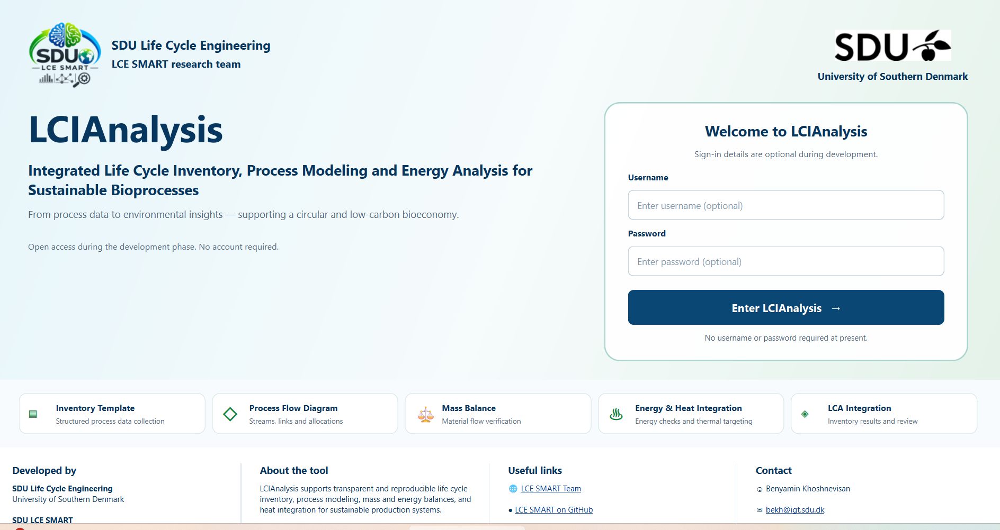
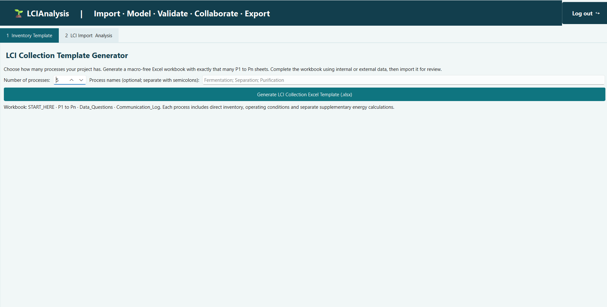
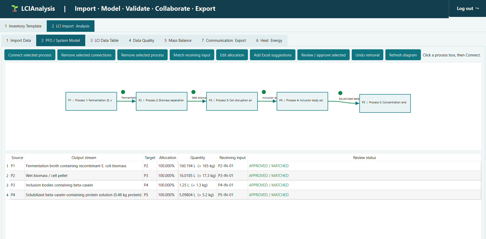
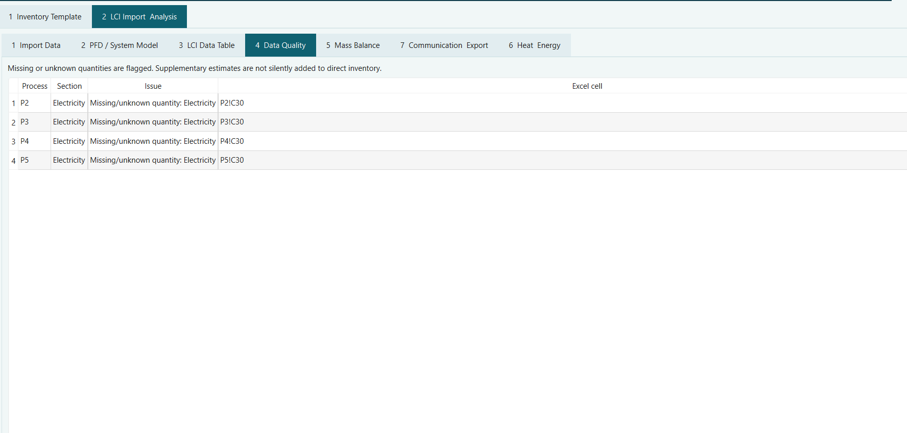
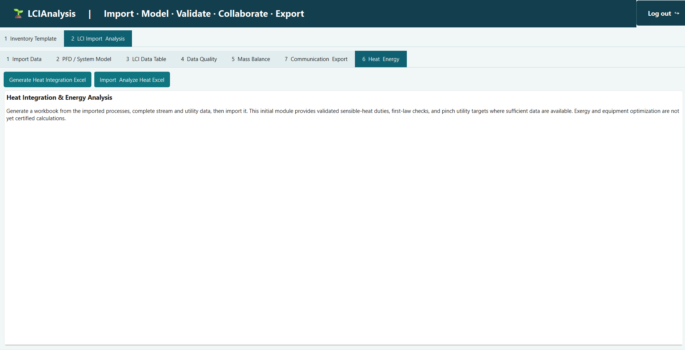

# LCIAnalysis

**Integrated Life Cycle Inventory, Process Modeling and Energy Analysis for Sustainable Bioprocesses**

**Version:** 2.0.0 (release preparation)  
**Institutional context:** SDU Life Cycle Engineering / LCE SMART, University of Southern Denmark  
**Availability:** Windows installer not yet published; functional testing and distribution approval pending.  
**Source code:** Private; this public repository contains documentation and approved software release assets only.

> **Publication status:** This is a documentation release candidate. Screenshots and branding require final approval before public upload. The Windows setup package is not available yet.

## Overview

LCIAnalysis is a Windows desktop application supporting structured life cycle inventory (LCI) development, process flow modeling, material-accounting checks, data-quality review, scientific communication, and emerging energy and system-integration workflows. It is intended for researchers, industrial partners, and LCA practitioners who need traceable process-level data before downstream life cycle assessment.

**Typical workflow:** Excel inventory template → import → process flow diagram and stream mapping → LCI review → data-quality checks → mass balance → energy review → optional heat integration → partner communication → scaling and multi-system integration → export.

LCIAnalysis is an inventory-development and review environment, **not a substitute for independently validated LCA impact assessment**. Numerical balance checks alone do not establish scientific completeness or physical feasibility.

## Interface and workflow

### 1. Inventory template creation

Create structured Excel collection workbooks with process sheets and project metadata for data providers.

### 2. Process flow diagram and stream connectivity

Visualize unit operations and streams, review output-to-input links and allocations, and export process diagrams. Diagram layout is distinct from scientific connection approval.

### 3. LCI tables and data quality

Review reported and derived quantities, original units, source references, missing values, and correction/query workflows.

### 4. Mass balance

Inspect known-input/output residuals, detailed calculations, process-level status and system visualizations. A provisional numerical pass is not independent scientific validation.

### 5. Energy balance and optional heat integration

Organize electricity, fuels, heat and cooling data. Thermodynamic and heat-integration analysis requires defensible properties, operating conditions and process boundaries.

### 6. Communication and exports

Track clarification queries and partner responses; export reviewable Excel, diagrams, and mass-balance reporting where supported by the tested release.

### 7. System scaling and integration (V2)

V2 includes workflows for reference-basis scaling, multi-workbook system connections, integrated diagrams and scenario review. These features remain subject to functional validation and scientific approval for individual studies.

See [Feature guide](docs/FEATURES.md) and [scientific limitations](docs/SCIENTIFIC_LIMITATIONS.md).

## Download and installation

**No public installer is available yet.** Once verified and institutionally approved, the Windows setup executable will be published under the GitHub **Releases** section (not committed to the documentation repository).

Planned filename: `LCIAnalysis_Setup_V2.0.0.exe`. Installation, license activation and system requirements will be confirmed in [INSTALLATION.md](INSTALLATION.md).

## Licensing and source availability

LCIAnalysis source code is **not distributed** in this repository. The software's final proprietary end-user terms and redistribution permissions are pending institutional approval. No open-source license is implied by the visibility of this repository. See [LICENSE.md](LICENSE.md).

## Citation and DOI

A Zenodo DOI will be added after the approved public GitHub release is archived. Do not cite an unissued DOI. See [CITATION.md](CITATION.md). Authorship and institutional attribution must be approved before publication.

## Release status

- V2.0.0 Python application was packaged using PyInstaller in a separate internal build.
- A versioned copy of the package was checked against the build: 4,800 files present, size-matched and MD5-matched.
- This verifies copy integrity **only**; it does not establish executable acceptance, installer readiness or distribution clearance.
- V1 and the private development repository remain preserved separately.

## Contact

Project contact details: **to be approved and inserted before publication**.

## Acknowledgments

Developed in the context of SDU Life Cycle Engineering / LCE SMART. Confirm individual contributors, funder acknowledgments, trademarks and institutional permissions before public release.
